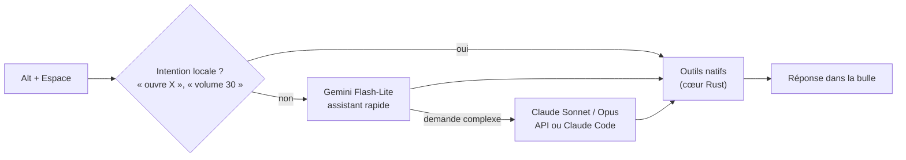

<div align="center">


# NozBar

**L'assistant vocal et textuel pour Windows, à un raccourci de distance.**

Appuie sur <kbd>Alt</kbd> + <kbd>Espace</kbd>, tape ou dis ce que tu veux, et NozBar agit directement sur ton PC.


<br />


</div>

---

## En action

<table>
  <tr>
    <td width="50%" valign="top">
      <br />
      <b>Une question, une réponse.</b> Appui court sur <kbd>Alt</kbd> + <kbd>Espace</kbd> : tu tapes, NozBar répond dans la bulle, puis disparaît.
    </td>
    <td width="50%" valign="top">
      <br />
      <b>Il agit, mais te laisse choisir.</b> « Ouvre la calculatrice » : en cas de doute, NozBar propose les correspondances au lieu de deviner.
    </td>
  </tr>
</table>

## Ce que NozBar sait faire

| | |
|---|---|
| 🚀 **Applications et jeux** | Ouvrir, fermer, basculer entre les fenêtres, lancer un jeu Steam (« ouvre Rocket League ») |
| 🌐 **Navigateur** | Fermer ou retrouver un onglet (« ferme YouTube »), résumer la page ouverte |
| 🔎 **Recherche web** | Réponses sourcées avec Gemini et Google Search, sources cliquables dans la bulle |
| 🖥️ **Écran et sélection** | « Qu'est-ce qu'il y a à l'écran ? », « traduis ça » sur le texte sélectionné, presse-papiers |
| 🔊 **Système** | Volume, sortie audio, micro, luminosité, mode sombre, musique en cours, veille et extinction |
| 📁 **Fichiers** | Chercher et ouvrir un fichier par son nom |
| ⏰ **Rappels** | Minuteurs et rappels à heure fixe, en notification Windows |
| 🧠 **Mémoire** | « Souviens-toi que… » : NozBar s'en sert dans toutes les conversations suivantes |
| 🎙️ **Voix** | Appui long sur le raccourci pour parler. Les silences sont ignorés pour que l'IA n'invente pas de commande |

## Comment ça marche



- **Les intentions simples restent en local.** « Ouvre X », « ferme Y » ou « volume à 30 » ne passent pas par une IA : c'est instantané et gratuit.
- **Aucune IA n'exécute de commande sur la machine.** Gemini et Claude renvoient seulement des *appels d'outils*, que NozBar exécute lui-même dans son cœur Rust, avec ses propres règles.
- **Délégation automatique.** Gemini Flash-Lite répond vite et décide seul de passer la main à Claude (Sonnet ou Opus) quand la demande l'exige. Claude passe par ta clé API ou par ton abonnement via Claude Code.
- **Permissions par catégorie.** Recherche web, lecture ou écriture hors du dossier de travail, exécution de programmes : pour chaque catégorie, tu choisis *Toujours*, *Demander* ou *Refuser*.
- **Les clés ne sont jamais écrites dans un fichier.** Elles restent dans le Gestionnaire d'identification Windows.

## Installation

### Prérequis

- Windows 11 (Windows 10 22H2 sans garantie)
- [Node.js](https://nodejs.org/) 20 ou plus
- [Rust](https://rustup.rs/) (toolchain stable) et les [prérequis Tauri pour Windows](https://tauri.app/start/prerequisites/)
- Une clé API [Gemini](https://aistudio.google.com/apikey). En option : une clé [Anthropic](https://console.anthropic.com/) ou [Claude Code](https://claude.com/claude-code), et une clé [Groq](https://console.groq.com/) pour la dictée

### Lancer en développement

```bash
git clone https://github.com/ferreroantoine/NozBar.git
cd NozBar
npm install
npm run tauri dev
```

### Construire l'installeur

```bash
npm run tauri build
```

L'installeur est créé dans `src-tauri/target/release/bundle/nsis/`.

Au premier lancement, ouvre les paramètres depuis l'icône de la zone de notification pour saisir tes clés et régler les permissions.

## Raccourcis

| Raccourci | Action |
|---|---|
| <kbd>Alt</kbd> + <kbd>Espace</kbd> (appui court) | Ouvrir la bulle en mode texte |
| <kbd>Alt</kbd> + <kbd>Espace</kbd> (appui long) | Parler (push-to-talk), envoyé au relâchement |
| <kbd>Entrée</kbd> | Envoyer |
| <kbd>Échap</kbd> | Fermer la bulle |

Si <kbd>Alt</kbd> + <kbd>Espace</kbd> est déjà pris (par PowerToys Run, par exemple), NozBar se replie sur <kbd>Ctrl</kbd> + <kbd>Alt</kbd> + <kbd>Espace</kbd>.

## Développement

```bash
npm test             # tests unitaires (Vitest)
npm run typecheck    # vérification TypeScript
cd src-tauri && cargo test
```

```
src/                 interface React : bulle, mascotte, paramètres
  lib/providers/     pilotes Gemini, Claude, Claude Code, Groq
  lib/tools/         catalogue d'outils partagé par les IA
  lib/router.ts      intentions locales traitées sans IA
src-tauri/src/       cœur Rust : raccourci, fenêtres, système, navigateur, écran, serveur MCP
docs/                cadrage, specs et plans
scripts/             bancs d'essai et vérifications de bout en bout
```

